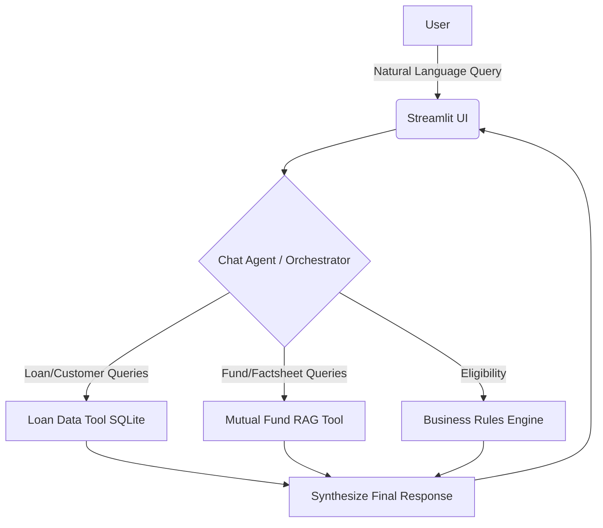

# Bajaj Finserv AI Customer Assistant 🏦

## Overview

Bajaj Finserv AI Customer Assistant is a Streamlit-based Hackathon prototype designed for existing loan customers. It provides a conversational interface where users can ask natural language questions about their loan accounts, receive accurate answers grounded in their real data, and explore mutual fund cross-sell opportunities based on their qualifications.

## The Solution We Crafted

We built a smart conversational AI assistant that acts as a secure, knowledgeable representative for Bajaj Finserv. Rather than answering from generalized LLM knowledge, it routes user queries to deterministic tools:

1. **Loan Data Engine**: Connects to a local SQLite database to answer customer-specific loan inquiries (EMI, outstanding balance, tenure, application score, etc.) securely and accurately without hallucinations.
2. **Mutual Fund RAG Engine**: Uses Retrieval-Augmented Generation (RAG) over the provided Bajaj Finserv AMC factsheet (PDF) to answer general mutual fund questions and provide transparent source references (page numbers, fund names, relevance scores).
3. **Cross-Sell Logic**: Evaluates if a user qualifies for mutual funds based on their loan profile (e.g., DPD status, Income, Application Score) and naturally introduces relevant products during the conversation.

## Architecture & Orchestration Flow

Our system architecture relies on a centralized **Chat Agent / Orchestrator** pattern built with **LangGraph** and **LangChain**:



### Agents & Orchestration Details

- **Single Agent Orchestrator**: Instead of using multiple independent conversational agents (which can lead to fragmented context), we use a single, highly capable orchestrator agent.
- **Tool Selection Flow**: The orchestrator understands the user's intent and dynamically selects the correct tool (Database Lookup vs. RAG Document Search). It supplies only the necessary context to each tool and synthesizes a natural language response.
- **Strict Source-of-Truth Policy**:
  - **Customer Data**: Strictly retrieved from SQLite. The LLM cannot invent financial numbers.
  - **Fund Data**: Strictly retrieved from the Factsheet PDF. The LLM explicitly states if information is missing from the document.

## Models & Technology Stack

- **Language Model**: **Llama 3.3 70B** accessed via **Groq API** for lightning-fast inference and superior reasoning capabilities.
- **Frontend**: **Streamlit** (with custom CSS for a premium, responsive UI).
- **Orchestration**: **LangChain** & **LangGraph**.
- **Vector Database**: **FAISS** (Lightweight, local vector store suitable for rapid prototyping).
- **Embeddings**: **Sentence Transformers** / HuggingFace.
- **Document Parsing**: **PyMuPDF** & **Unstructured** for robust PDF data extraction.
- **Observability**: **LangSmith** for tracing agent tool calls and reasoning processes.
- **Data Storage**: **SQLite** for user loan data.

## Key Features

- 🔐 **Demo Login**: Authenticate seamlessly using Name or Phone Number.
- 💬 **Context-Aware AI**: Maintains conversation history for natural follow-up questions.
- 📊 **Transparent Source Citations**: The UI displays expandable "Sources Used" cards (showing page numbers, sections, and snippets) whenever the agent answers from the factsheet.
- ✅ **Factually Grounded Badges**: Visual indicators when responses are successfully grounded in the source PDF.

---

## Getting Started

### Prerequisites

- Python 3.11+
- API Keys for **Groq** (and **LangSmith** if tracing is enabled)

### Installation

1. **Clone the repository.**
2. **Create a virtual environment:**
   ```bash
   python -m venv venv
   # On Windows:
   venv\Scripts\activate
   # On macOS/Linux:
   source venv/bin/activate
   ```
3. **Install dependencies:**
   ```bash
   pip install -r requirements.txt
   ```
4. **Environment Variables:**
   Create a `.env` file in the project root with the following:

   ```env
   GROQ_API_KEY=your_groq_api_key_here

   # Optional: LangSmith Tracing
   LANGCHAIN_TRACING_V2=true
   LANGCHAIN_API_KEY=your_langchain_api_key_here
   LANGCHAIN_PROJECT=bajaj_finserv_assistant
   ```

### Running the Application

1. **Initialize the Database**: If `customer_data.db` is not already populated, run the DB creation script:
   ```bash
   python create_customer_db.py
   ```
2. **Start the Streamlit Server**:
   ```bash
   streamlit run app.py
   ```
3. Open `http://localhost:8501` in your browser. Log in using a demo name or phone number from the CSV/SQLite database to start exploring!

# ADDING VOICE FEATURE
